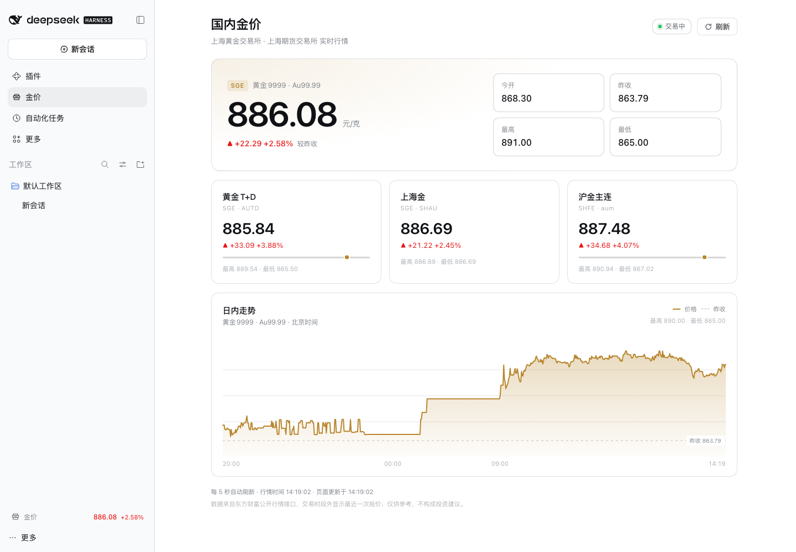

# dsh-gold-price

English | [中文](README.md)



A Web client plugin for DeepSeek Harness: it keeps the domestic gold price in the sidebar and adds a dedicated **Gold Price** panel with live quotes and an intraday chart.

## Features

- **Always-visible sidebar ticker** — the bottom of the sidebar shows the latest Au99.99 price and change; clicking it opens the full panel. The collapsed rail keeps a gold-bars icon.
- **Live panel**
  - Au99.99 (SGE) primary quote: last, change, change %, open, previous close, high, low.
  - Cards for Gold T+D, Shanghai Gold and SHFE gold front-month.
  - Au99.99 intraday chart with a hover readout for every minute point.
  - Trading / closed status, quote time, page refresh time and a manual refresh button.
- Quotes refresh every 5 seconds and the intraday chart every 30 seconds. Polling pauses while the page is hidden and resumes immediately when visible.
- Follows the active light/dark theme and adapts to narrow windows.

## Data source

Quotes and intraday data come from Eastmoney's public market endpoints:

- `https://push2.eastmoney.com/api/qt/ulist.np/get`
- `https://push2.eastmoney.com/api/qt/stock/trends2/get`

Contracts: `118.AU9999` (Au99.99), `118.AUTD` (Gold T+D), `118.SHAU` (Shanghai Gold), `113.aum` (SHFE gold front-month).

Quotes may be delayed; outside trading hours the last quote is shown. This plugin is display-only and is not investment advice.

## Install

From npm (after publishing):

```bash
dsh plugin --profile desktop add dsh-gold-price
```

From a local checkout:

```bash
dsh plugin --profile desktop add /absolute/path/to/dsh-gold-price
```

The package is a DSH profile bundle, so the installer selects it in `dsh.profile.bundles`. If the running window does not show the ticker yet, reload the window once (or restart Harness).

Uninstall:

```bash
dsh plugin --profile desktop remove dsh-gold-price
```

## Structure

| File | Purpose |
| --- | --- |
| `cordis.patch.yml` | Bundle patch: inserts the `gold-price` plugin row into the profile |
| `lib/index.js` | Host half: empty `apply()`, only provides the Loader row |
| `lib/client.js` | Browser half: polling, shared quote store, sidebar entries, panel and chart |

## Implementation notes

- Quotes and the chart share one module-level store, so the sidebar ticker and the panel share one polling loop instead of issuing duplicate requests.
- `useSyncExternalStore` subscribes components to the store; when the last subscriber unmounts, all timers stop.
- The browser half is plain JavaScript (no JSX, no build step), delivered as DSH's `window.__ModuleLoader__.load({ id, factory })` bundle. React comes from the client module system.
- Three slots are registered through `ctx.slots`: `main` (panel), `sidebar.panellist` (panel entry), and `sidebar.footer.action` (sidebar ticker).

## Compatibility

- DSH `>=0.2.1-rc.5` (Web client with `ctx.slots` and `ctx.layout`).
- Tested on macOS with the desktop Web shell at 1440px and 760px widths.

## License

MIT
