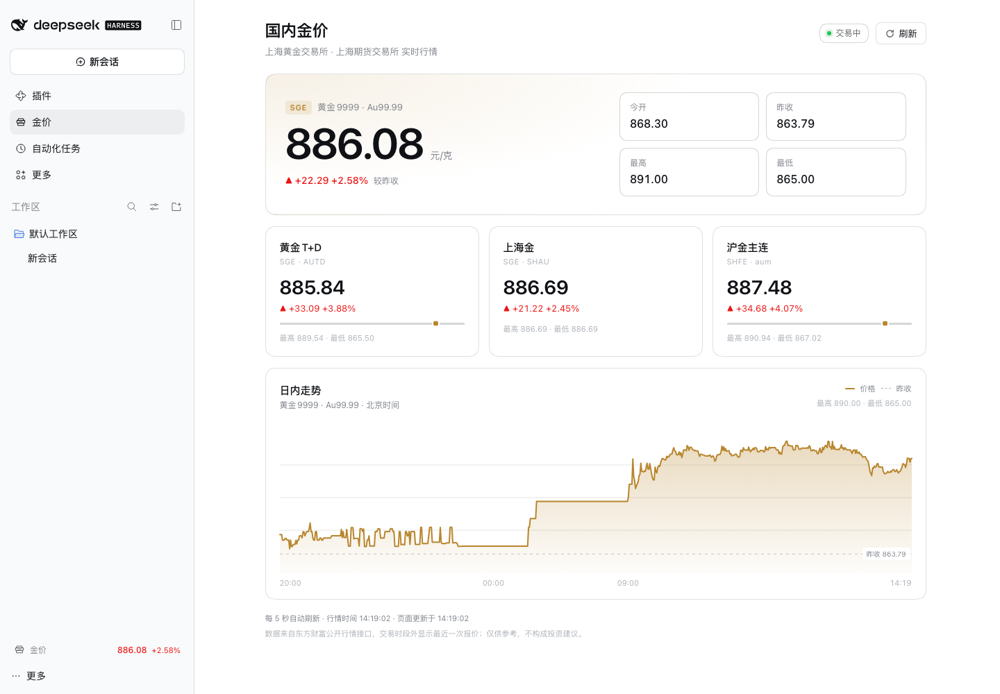

# dsh-gold-price

[English](README.en.md) | 中文



DeepSeek Harness 的 Web 客户端插件：在侧栏常驻显示国内金价，并提供一个可打开的「国内金价」实时面板。

## 功能

- **侧栏常驻行情**：侧栏底部显示黄金 9999 最新价与涨跌幅，点击打开完整面板；侧栏收起时保留金色金条图标。
- **实时面板**：
  - 黄金 9999（Au99.99，上海黄金交易所）主报价：最新价、涨跌额、涨跌幅、今开、昨收、最高、最低；
  - 黄金 T+D、上海金、沪金主连（上海期货交易所）三张行情卡；
  - 黄金 9999 日内分时走势图（支持鼠标悬停查看每个分钟点的价格）；
  - 交易中 / 已休市状态、行情时间、页面刷新时间与手动刷新。
- 每 5 秒刷新报价，每 30 秒刷新分时走势；页面隐藏时暂停请求，重新可见时立即刷新。
- 自动适配浅色 / 深色主题与窄窗口。

## 数据来源

报价和分时数据来自东方财富公开行情接口：

- `https://push2.eastmoney.com/api/qt/ulist.np/get`
- `https://push2.eastmoney.com/api/qt/stock/trends2/get`

合约：`118.AU9999`（黄金 9999）、`118.AUTD`（黄金 T+D）、`118.SHAU`（上海金）、`113.aum`（沪金主连）。

行情可能延迟，交易时段外显示最近一次报价；本插件仅供展示，不构成投资建议。

## 安装

插件以 profile bundle 的形式安装。先构建 / 准备好本目录，然后：

```bash
dsh plugin --profile desktop add /absolute/path/to/dsh-gold-price
```

再把包名加入 profile 的 `package.json` 中的 `dsh.profile.bundles`：

```json
{
  "dsh": {
    "profile": {
      "bundles": [
        "@deepseek-ai/dsh-base",
        "@deepseek-ai/dsh-web-app",
        "dsh-gold-price"
      ]
    }
  }
}
```

重启 Harness（或让配置热重载生效）后，侧栏底部会出现金价行情，侧栏导航会出现「金价」面板入口。

卸载：

```bash
dsh plugin --profile desktop remove dsh-gold-price
```

并从 `dsh.profile.bundles` 中移除 `dsh-gold-price`。

## 结构

| 文件 | 说明 |
| --- | --- |
| `cordis.patch.yml` | bundle patch：向 profile 插入 `gold-price` 插件行 |
| `lib/index.js` | Host 半：空 `apply()`，只提供 Loader 行 |
| `lib/client.js` | 浏览器半：数据轮询、共享行情 store、侧栏入口、实时面板与分时图 |

## 实现说明

- 报价与分时共用一个模块级 store，侧栏 ticker 与面板共享同一份轮询，不会重复请求。
- `useSyncExternalStore` 订阅 store；组件卸载时最后一个订阅者会停止全部定时器。
- 浏览器半是纯 JavaScript（无 JSX、无构建步骤），以 Harness 的 `window.__ModuleLoader__.load({ id, factory })` 形式交付，React 由客户端模块系统提供。
- 通过 `ctx.slots` 注册三个位置：`main`（面板）、`sidebar.panellist`（面板入口）、`sidebar.footer.action`（侧栏常驻行情）。
